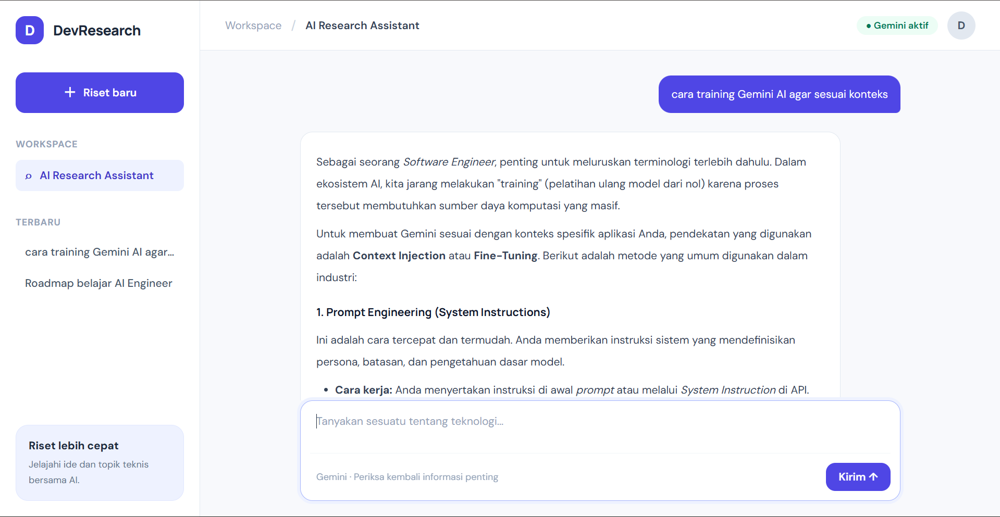
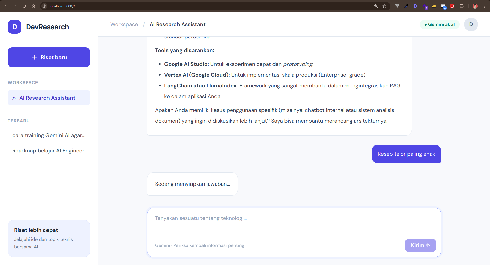
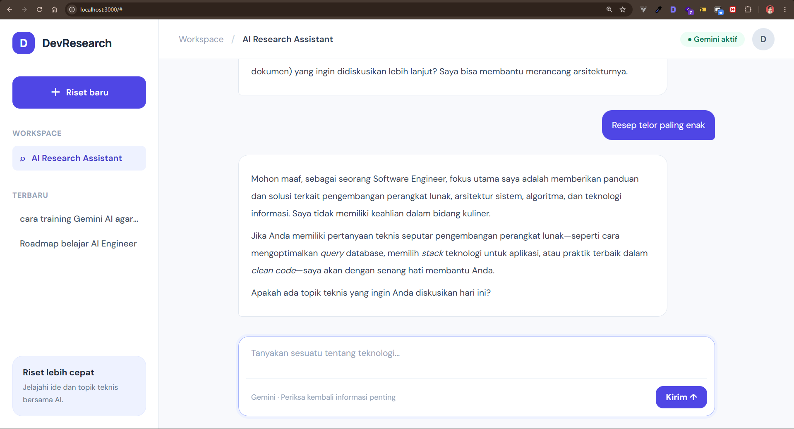
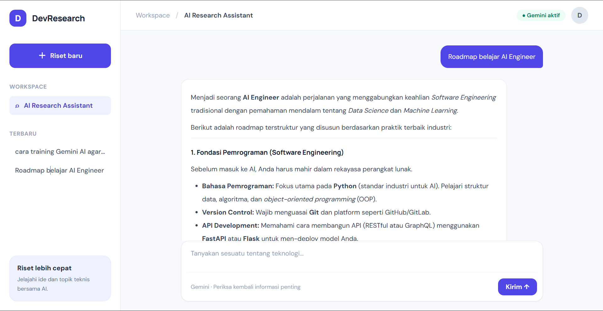

# AI Productivity & AI API Integration for Developer
Proyek ini merupakan tugas akhir yang dirancang untuk meningkatkan efisiensi alur kerja pengembang (developer) melalui integrasi kecerdasan buatan. Aplikasi ini memanfaatkan Google Gemini AI untuk membantu otomatisasi tugas-tugas rutin pengembangan perangkat lunak.

## 🚀 Deskripsi Proyek
Aplikasi ini dibangun menggunakan Express.js sebagai backend untuk mengelola permintaan API dan berinteraksi dengan model bahasa besar (LLM) dari Google Gemini. Fokus utama proyek ini adalah menyediakan antarmuka atau endpoint yang memungkinkan pengembang untuk melakukan code generation, debugging, atau documentation generation secara instan.

## 🛠 Tech Stack
- Backend: Express.js (Node.js framework)
- AI Engine: Google Gemini API
- Language: JavaScript / TypeScript
- Environment: Node.js

## 📋 Fitur Utama
- AI Code Assistant: Membantu menulis potongan kode berdasarkan prompt.
- Automated Debugging: Menganalisis error log dan memberikan saran perbaikan.
- Documentation Generator: Membuat dokumentasi fungsi secara otomatis dari kode yang diberikan.

## Screenshoot
- Traing AI

- Loading Response

- Error Context 
 

- Another Ask
